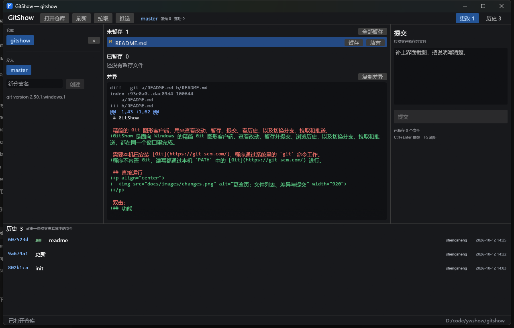
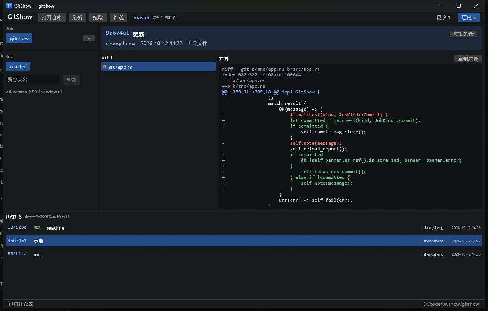

# GitShow

GitShow 是面向 Windows 的精简 Git 图形客户端。查看改动、暂存并提交、浏览历史，以及切换分支、拉取和推送，都在同一个窗口里完成。

程序不内置 Git，读写都通过本机 `PATH` 中的 [Git](https://git-scm.com/) 进行。

<p align="center">
  
</p>

更改页左侧是最近仓库和分支，中间是改动与差异，右侧填写提交说明。

## 功能

- **打开仓库**：选择文件夹，或把文件夹拖进窗口。拖入的如果是文件，则使用它所在的目录。
- **更改**：未暂存、已暂存和冲突分开列出，可暂存、取消暂存或全部处理。放弃更改、删除未跟踪文件前会先确认。
- **差异**：点选文件查看差异，也可复制差异文本。
- **提交**：只提交已暂存的文件。提交成功后打开这次记录，并列出其中的文件。
- **历史**：窗口下方始终显示最近的提交。点开一条记录可查看文件与差异，并复制完整哈希。
- **分支**：左侧列出本地分支，点击即可切换。填写名字后创建，并立即切过去。
- **拉取 / 推送**：使用工具栏按钮。当前分支还没有上游时，推送会执行 `git push -u origin HEAD`。工具栏同时显示当前分支，以及相对上游领先、落后，或上游已删除。

最近打开过的仓库会保留。下次启动时自动打开最后一个。

## 历史

<p align="center">
  
</p>

在下方历史里点一条提交，即可查看其中的文件和差异。

## 运行

确认 `git` 已在 `PATH` 中，然后双击：

```text
dist\GitShow.exe
```

从源码直接运行：

```text
cargo run
```

## 从源码构建

需要 Rust 1.85 或更新版本（`edition = 2024`）。使用 GNU 工具链时，`gcc` 也要在 `PATH` 中。

```text
cargo build --release
```

生成的程序在 `target\release\GitShow.exe`。

## 快捷键

| 按键 | 作用 |
| --- | --- |
| `F5` | 刷新状态和历史 |
| `Ctrl+Enter` | 提交已暂存的文件 |

## 本机数据

| 路径 | 内容 |
| --- | --- |
| `%APPDATA%\GitShow\state.json` | 最近打开的仓库 |
| `%APPDATA%\GitShow\panic.log` | 异常退出时的详情 |

## 许可

MIT
